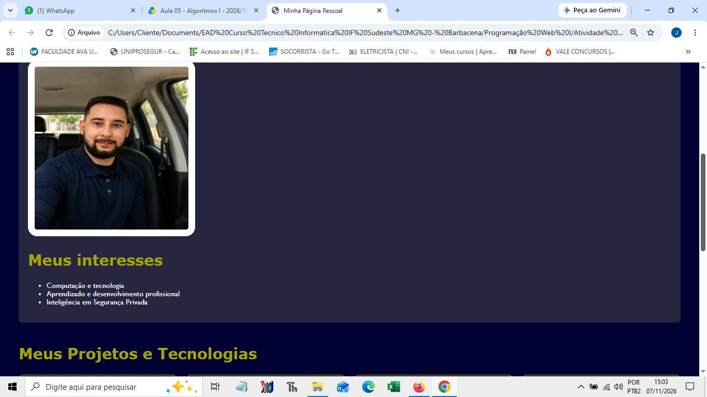
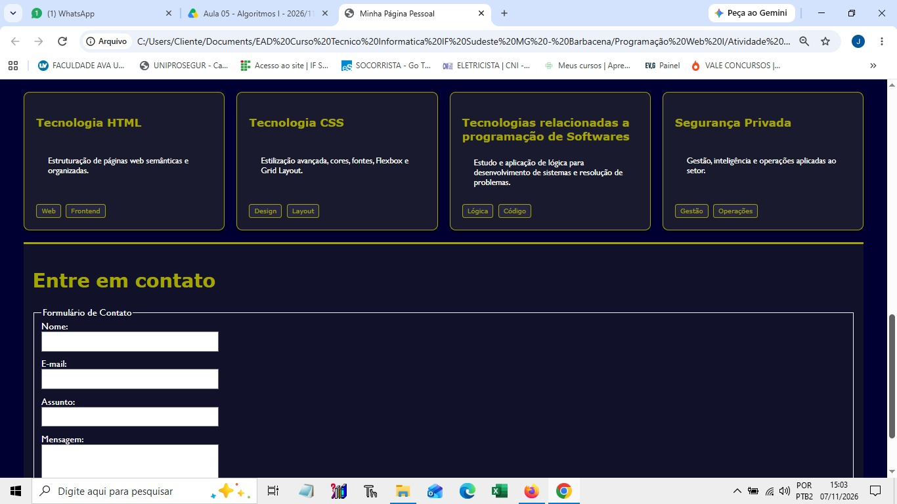
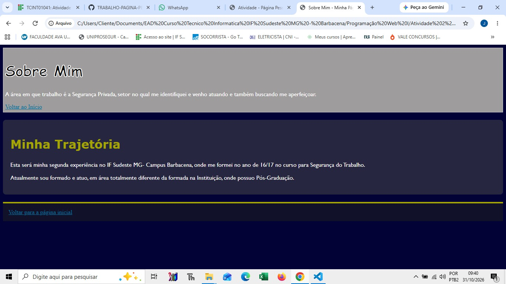
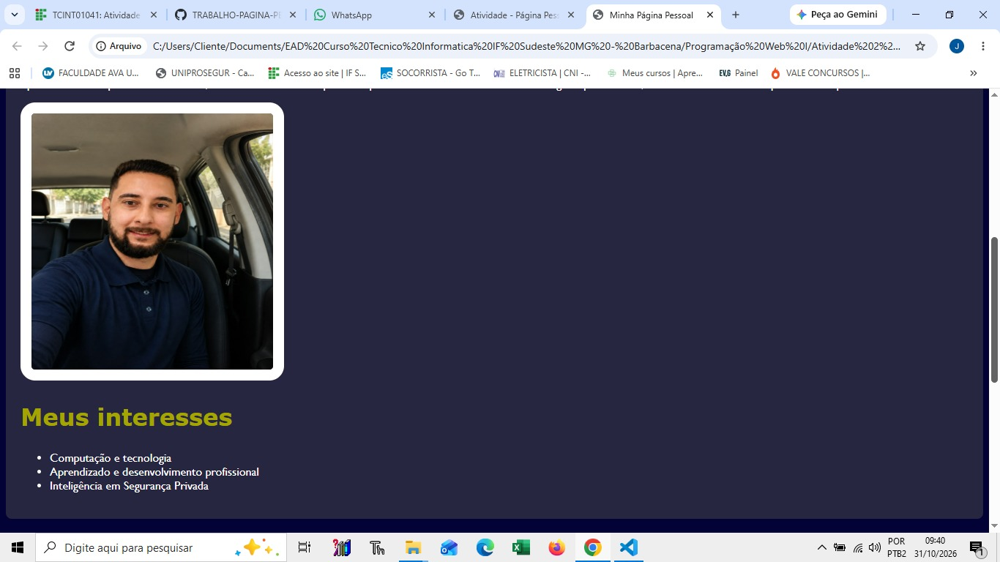
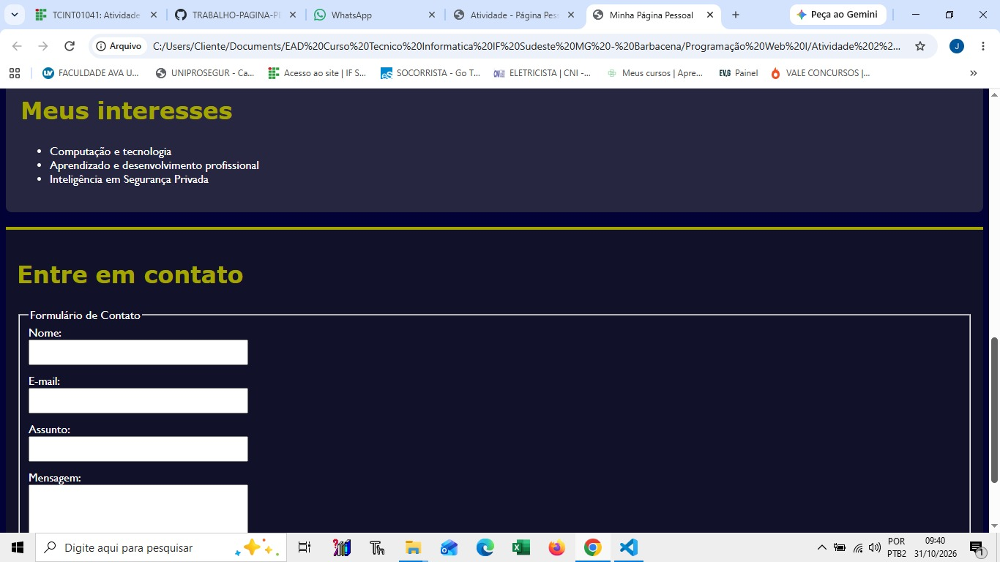
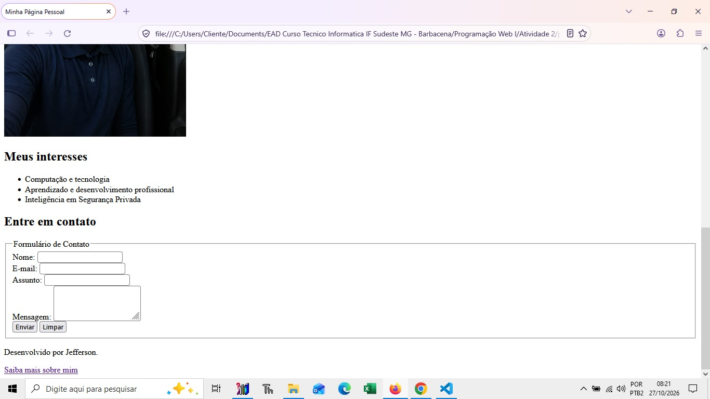
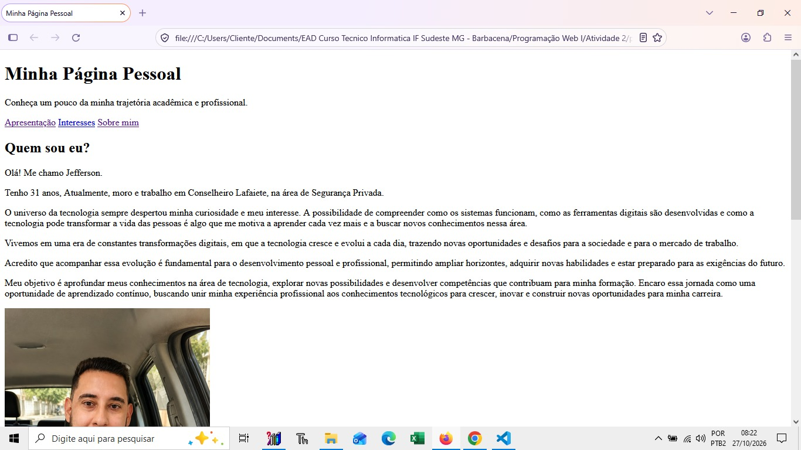

## Sobre Mim
Nome: Jefferson Geraldo Henriques Barbosa Silva
Curso Tecnico em Informática para Internet - IF SudesteMG Campus Barbacena

## Sobre a atividade
Esta é minha página pessoal desenvolvida na disciplina Programação Web.

## Tecnologias utilizadas:
HTML
Git
GitHub
Css
Capturas de tela

## Histórico do Projeto e Atividades
Atividade 1 e 2: Estrutura Base
 * Criação e estruturação inicial da página HTML.
 * Adição do cabeçalho (header), seção de apresentação e seção "Sobre".
 * Organização inicial da pasta e arquivos do projeto.
   
## Atividade 3: Formulário de Contato
 * Criação da seção de contato com formulário estruturado.
 * Utilização das tags HTML: <form>, <input> (nome, e-mail, assunto), <textarea> (mensagem) e botões de envio e limpeza (reset).
   
## Atividade 4: Estilização com CSS
 * Aplicação de estilos globais e personalização visual da página.
 * Ajuste de cores, tipografia (fontes e tamanhos) e espaçamentos (margens e paddings).
 * Estilização do cabeçalho, menu de navegação e rodapé (footer).
 * Formatação das imagens (adição de bordas e alinhamento).
 * Ajustes visuais nos títulos e textos principais.

## Atividade 5: Organização Avançada com CSS Grid e Flexbox
Nesta atividade, o foco foi a aplicação prática de técnicas avançadas de layout e estruturação de páginas web utilizando CSS Grid e Flexbox.
 * Estrutura com CSS Grid: Organização estrutural geral da página (cabeçalho, conteúdo principal e rodapé) utilizando grid-template-areas e grid-template-rows.
 * Disposição de Cartões (Cards): Criação de um layout responsivo para cartões utilizando display: grid com auto-fit e minmax.
 * Alinhamento com Flexbox: Emprego de flexbox (display: flex, flex-direction: column e justify-content: space-between) dentro dos elementos para garantir que o conteúdo interno e as tags fiquem perfeitamente alinhados e distribuídos.
 * Estilização Visual: Customização de cores, tipografia, bordas arredondadas e efeitos de transição interativos (hover).

## Atividade 6: Implementação de design responsivo ##
Utlização de CSS Grid;
Flexbox e Media Queries;
Garantia de adaptação do Laout em diferentes tamanhos de tela, como celular e tablets. 

